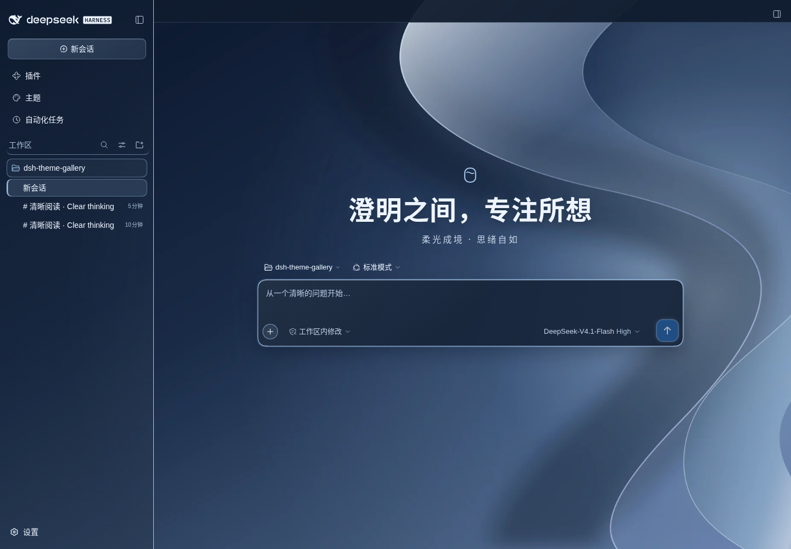

# DSH Theme Gallery

[简体中文（默认）](README.md) | **English**

One plugin, twelve themes for DeepSeek Harness. Open the sidebar **Themes** center to choose a theme. Select **DSH default** to restore the built-in appearance. DSH restores your saved theme after a restart.

## Themes and appearance

Each theme includes a color palette, scene wallpaper, headline, and input hint. The wallpaper covers the actual conversation area. A gradient behind the text keeps messages readable.

| Theme | Preview | Style |
| --- | --- | --- |
| Mountains & Ink · 山河剑意 | [View preview](themes/shanhe/assets/concept-preview.webp) | Paper, ink landscapes, vermilion, flowing ink lines |
| Giant of Light · 光之巨人 | [View preview](themes/ultraman/assets/concept-preview.webp) | Ultraman-inspired red and silver, stars, blue energy |
| Immortal Emperor · 荒天帝意象 | [View preview](themes/perfect-world/assets/concept-preview.webp) | Perfect World-inspired black and gold armor, red cape, celestial palaces |
| Flame Emperor · 炎帝意象 | [View preview](themes/flame-emperor/assets/concept-preview.webp) | Battle Through the Heavens-inspired black robes, heavy blade, cyan fire lotus, volcanoes |
| Great Sage · 齐天大圣 | [View preview](themes/great-sage/assets/concept-preview.webp) | Golden eyes, staff, clouds, celestial palaces |
| Nezha · 哪吒 · 莲身破浪 | [View preview](themes/nezha/assets/concept-preview.webp) | Red ribbon, ring, spear, fire wheels, lotus and waves |
| Whale Prince · 鲸少 · 沧海之主 | [View preview](themes/whale-prince/assets/concept-preview.webp) | Ocean guardian, giant whale, deep-sea kingdom |
| A Liang · Rain Road · 阿良 · 雨夜行 | [View preview](themes/jianlai-aliang/assets/concept-preview.webp) | Traveler, bamboo hat, rainy night, warm lamps, sword light |
| Sunny Watch · 晴空守望 | [View preview](themes/sunny-watch/assets/concept-preview.webp) | Morning city, clear sky, warm sunlight |
| Young Goku · Nimbus Journey · 少年悟空 | [View preview](themes/young-goku/assets/concept-preview.webp) | Young Goku, Flying Nimbus, Power Pole, bright landscapes. Unofficial fan theme. |
| Wang Lin · Renegade Immortal · 王林 | [View preview](themes/wang-lin/assets/concept-preview.webp) | Silver-white hair and robes, slate mountain mist, cinnabar accents, a split red/silver seal. Unofficial Renegade Immortal fan theme. |
| Aqua Glass · 琉璃 | [View preview](themes/aqua-glass/assets/concept-preview.webp) | Original silver-blue abstract curves, restrained glass edges and opaque reading/code surfaces. |

The plugin uses newly made visual assets. Character themes are unofficial fan designs. New artwork does not mean original ownership of the characters or permission from their rights holders.

Four sliders adjust the appearance across all twelve themes:

| Control | Default | Effect |
| --- | --- | --- |
| Background depth | 0% | Adjusts the color mask over the conversation wallpaper |
| Sidebar mask | 40% | Adjusts the color mask over the sidebar wallpaper |
| Scene blur | 0 px | Adjusts wallpaper blur |
| Text contrast | 100% | Adjusts text contrast |

Slider changes take effect immediately and remain on the current device after a restart. These controls do not change built-in DSH themes. The theme center uses its own translucent background.

During a model response, each theme shows its own text, elapsed time, and small animated mark in the native status area. The plugin supports the separate DSH 0.2 status row. With reduced motion enabled, the mark stays still.

Version 0.3.18 fixed duplicate native whale effects and theme marks on DSH 0.2.0-rc.2. It also fixed old startup colors that overrode the saved theme and made text black. The compact status row keeps its text and timer clear.

Version 0.3.19 fixed A Liang, Sunny Watch, and Young Goku being rejected by the Host and falling back to an older theme after a restart. All ten themes now hide the home "preview" badge and keep the same native layout and controls; all ten also play a startup intro with their own palette, artwork, and copy (Shanhe keeps its ink sample, the other nine use dedicated vector scenes).

On Windows desktop, the title bar uses a solid theme color. The sidebar wallpaper and mask remain adjustable. The plugin styles the existing sidebar, conversation, and input card without replacing their functional buttons.

Shanhe uses a WebP ink landscape instead of the older abstract SVG mountains.

Version 0.3.20 adds **Wang Lin · Renegade Immortal**, with silver-white robes, slate mountain mist, and restrained cinnabar accents. The native home, sidebar, title bar, composer, and running status share the palette. Active replies retain their timer beside a softly breathing red/silver seal; the startup intro reveals the seal through mist. It uses the same four sliders and the existing single installation.

## Aqua Glass and global startup preference (v0.3.23 source)

**This is unpublished source for review.** Registry/CDN v0.3.22 below remains the existing eleven-theme release; its artifact and checksum are unchanged. The new source includes twelve themes and the audited lifecycle fixes.

**Aqua Glass** uses an original locally bundled WebP wallpaper (MIT-authored SVG source), silver-blue lighting, and two restrained glass surfaces: sidebar and composer. Messages and code have high-opacity backgrounds. Native menus and syntax colors remain native. Unsupported backdrop-filter falls back to opaque surfaces; narrow composers disable blur. No Apple wallpaper, Dock, system menu bar or extra runtime dependency is used.

In **Themes**, below **Scene and text**, **Startup intro animation** applies globally. Default: **on** for existing users. Turn it off to close an active opening immediately and suppress refresh/restart playback for every theme. Turning it on never opens a scene immediately; the next eligible page startup may play. The switch stays available on DSH default/light/dark. Reduced motion, Skip/Esc, the four-second limit and no replay on theme changes remain intact; running response status/timers are unaffected.

The controller stores `dsh.themeGallery.startupIntro.enabled` as `true`/`false` in browser storage; missing/invalid data defaults on. Storage failures preserve the session preference. Update baselines add optional `configuration.startupIntro` and keep schema 1 compatible. Restore its raw value to this owned key; absent/null means remove only this key (default on), never clear localStorage. Theme selection, four sliders, unknown baseline fields and other plugins remain unchanged. Uninstall releases all effects but preserves these owned preferences for reinstallation. Select **DSH default** to restore native styling.



Exact test evidence and NOT TESTED platform limits: [Aqua Glass acceptance](docs/AQUA-GLASS-ACCEPTANCE.md). No new compatibility range is claimed beyond the existing declaration.

## Installation

The published v0.3.22 package below contains eleven themes. The unpublished v0.3.23 review source adds Aqua Glass as the twelfth theme in the same unified bundle. Pick either installation route for the published package.

> **Release vs. source**: the registry/CDN `0.3.22` commands below install the previously published artifact. The October 2026 lifecycle fixes merged into `main` (correct scoped plugin details, aborted requests and route disposal) have **not** been republished (the current review candidate is `0.3.23`). Do not overwrite a published package using the same version.

### Option 1: npm package name (recommended)

The registry package is `@xuanyi-king/dsh-theme-gallery` (currently `0.3.22`).

1. Open **Plugins → Add plugin** in DSH.
2. Paste the package name into the input field:

```text
@xuanyi-king/dsh-theme-gallery
```

3. Select **Install**.
4. Open the sidebar **Themes** center.
5. Select a theme card.

### Option 2: CDN release tarball (when the registry is unreachable)

To install from the release tarball instead:

1. Open **Plugins → Add plugin** in DSH.
2. Paste this tarball URL into the input field:

```text
https://cdn.jsdmirror.com/gh/Xuanyi-king/dsh-theme-gallery@v0.3.22/artifacts/xuanyi-king-dsh-theme-gallery-0.3.22.tgz
```

3. Select **Install**.
4. Open the sidebar **Themes** center.
5. Select a theme card.

### Web profile

Run:

```bash
dsh plugin --profile web add @xuanyi-king/dsh-theme-gallery
```

> A registry spec skips the GitHub reachability pre-check (non-git specs return early) and clones no git history; pnpm fetches only the 2.6MB release. Measured on a restricted network: `registry.npmmirror.com` at about 2.75MB/s, 6s end to end with dependencies on a cold store, and 35ms for a repeat `pnpm install` from cache. `registry.npmjs.org` is frequently unreachable from such networks.
>
> If the official registry is unreliable for you, add `@xuanyi-king:registry=https://registry.npmmirror.com/` to the profile's `.npmrc` (that routes this scope only). Do not switch the global registry: the profile depends on several very new alpha versions and npmmirror lags behind them.
>
> Installing a just-published version makes pnpm's `minimumReleaseAge` policy record it in `minimumReleaseAgeExclude` in the profile's `pnpm-workspace.yaml` (it prints `Added 1 entry to minimumReleaseAgeExclude`). Expected; the install continues.

### Tarball route: desktop and CLI

On the command line, the tarball route is:

```bash
dsh plugin --profile web add "https://cdn.jsdmirror.com/gh/Xuanyi-king/dsh-theme-gallery@v0.3.22/artifacts/xuanyi-king-dsh-theme-gallery-0.3.22.tgz"
```

> The URL ends in `.tgz`, so DSH parses it as a remote tarball spec: non-git specs skip the GitHub reachability pre-check, and pnpm downloads a 2.6MB tarball instead of cloning git history (about 3s end to end with dependencies).
>
> The tarball under `artifacts/` is byte-identical to the one uploaded to npm: sha1 `55d75156c2715932f60f4f71e88851bd0b971c0f`, sha512 `sha512-BHdrDHQF2xrBTvxFeP72UyNUMibgioIa+skOP07tTSlThWnuCyHVDOPVUaX5dF4hx8fYOjVDlB1Ksx/VvltEow==`.
>
> jsDelivr endpoint reachability varies wildly per network. Measured on a restricted network (2.6MB): `cdn.jsdmirror.com` 0.5–3s ✅, `testingcf.jsdelivr.net` 0.2–1s ✅, `jsd.nn.ci` 0.7–3.4s ✅, `jsdelivr.b-cdn.net` 3–4s ✅, `fastly.jsdelivr.net` and `quantil.jsdelivr.net` about 20s+, `cdn.jsdelivr.net` gets its connection reset ❌, `gcore.jsdelivr.net` may have an intercepted certificate ❌, `jsd.cdn.zzko.cn` has an expired certificate ❌. **If that host is unreachable for you, swap it for any ✅ endpoint above** — the path and the file are identical (verify with the sha1 after downloading).
>
> pnpm has a known edge with remote-tarball dependencies: when the tarball is already in the pnpm store but the lockfile entry carries no `integrity` field, it reports `ERR_PNPM_MISSING_TARBALL_INTEGRITY`. A normal first install downloads the tarball and records the integrity in `pnpm-lock.yaml`, after which `pnpm install` hits the cache (measured 35ms). If you do hit that error, reinstall with a different endpoint host (the changed URL forces a fresh download and the integrity is filled in), or run `pnpm store prune` first.

> Do not install from the GitHub repository address. A `https://github.com/...` or `github:` spec makes pnpm clone the entire git history (this repository's snapshot is about 21MB), and DSH runs a GitHub reachability pre-check first (5s default timeout) that fails outright as `spec-host` on GitHub-restricted networks.

> Before 0.3.21 the published name was `dsh-theme-gallery` (installed from the GitHub address). The name changed to avoid an unrelated npm package that already owned it. Remove the old `dsh-theme-gallery` dependency before installing the new name, or two bundles will insert the same plugin.

Then open the sidebar **Themes** center. The published v0.3.22 package includes eleven themes; the v0.3.23 source adds the twelfth.

After an upgrade, close and reopen DSH to load the new plugin. DSH restores your saved theme. If older standalone theme plugins remain installed, remove them to prevent competing styles.

## DSH compatibility, update and uninstall (October 2026 audit)

- **Verified** in isolated Linux / Node.js 24 environments using local tarballs: DSH `0.2.0-rc.2` and `0.2.1-alpha.2`, Web/Chromium boot, switching, native plugin details, disable/remove/reinstall, and coexistence with the other three plugins. Windows Desktop, old unscoped-package migration and other versions inside the declared `>=0.2.0-0 <0.3.0` peer range are **NOT TESTED**.
- **One package**: use `@xuanyi-king/dsh-theme-gallery`. Remove any old unscoped `dsh-theme-gallery` bundle or separately installed legacy theme bundles before activating the new gallery; never clear user theme data as part of removal.
- **Upgrading**: the built-in update center checks compatibility and saves a recovery baseline; it does **not** run npm/pnpm or automatically replace the plugin. From an external terminal, stop the Host and preserve the fixed original artifact/Profile lock. After upgrading only this package, restart the Host, hard-refresh the browser, and verify the Client/Host/manifest and one `active` entry.
- **Uninstalling**: stop the Host and remove this bundle in the native manager or use `dsh plugin --profile web remove @xuanyi-king/dsh-theme-gallery` for the correct CLI Profile. Route handlers, UI/theme registrations and requests are disposed; **data is preserved by default**, including `$DSH_HOME/dsh-theme-gallery/selection.json`, recovery baselines, and the browser's `dsh.themeGallery.selection` / `dsh.themeGallery.visual` keys.
- **Validation**: author-reported root tests **93/93 PASS** plus the existing standalone-theme suites and targeted real-Host tests. A full Windows/Desktop and all-themes/all-sliders regression was not repeated. A source merge does not imply a new npm release.

For source evidence and the exact test limits, see [DSH lifecycle audit](docs/DSH-LIFECYCLE-AUDIT.md).

## v0.3.22: client module id fix

After the rename, the client bundle still registered the old plugin id `dsh-theme-gallery` while the DSH runtime keys its boot graph and client entry roster by **package name**, so the two never matched and the page stopped at `web boot: 1 entry did not activate`. In 0.3.22 the bundle registers the package name (the build script derives it from `package.json.name`), and the safe-update artifact check now enforces "registered id must equal the manifest package name"; `test/bundle.test.mjs` and `test/update.test.mjs` each lock that invariant.

If you installed 0.3.21, upgrading to 0.3.22 is enough — no manual edits.

## v0.3.21: dedicated theme center and safe updates

Select **Themes** below **Plugins** in the sidebar. The native panel supports its collapsed palette icon, keyboard navigation and Chinese/English labels. Closing the page keeps the theme active. The old `settings.section` contribution is removed; `shell.overlay` startup intros remain.

The top panel separates the running Client version, disk manifest, installation source, reliable locked commit, build fingerprint, DSH/Node and remote target. A single nonblocking startup check is read-only; nothing installs automatically. Checks prefer verified stable GitHub Releases, otherwise fetch the default branch commit and its pinned manifest/bundle from the fixed official repository. README text is never a version source. Network failures, proxy issues, rate limits, timeouts, older remote data or historical artifacts without metadata remain failed/unknown.

| DSH | v0.3.21 support |
| --- | --- |
| `0.2.1-alpha.1` | Primary target, pinned official tag; actual Web evidence in acceptance record |
| `0.2.0-rc.2` | Regression target with the same main/sidebar/Connection contract |
| Other `0.2.x`, prereleases included | Peer range `>=0.2.0-0 <0.3.0` matches automatically on the same main/sidebar/Connection contract |
| `0.1.x` and `>=0.3.0` | Unverified; do not widen peers or force an incompatible install |

Node requires `^22.19.0 || >=24`. The DSH peer is `>=0.2.0-0 <0.3.0`: the floor is written `0.2.0-0` rather than `0.2.0` so prereleases such as `0.2.0-rc.2` and `0.2.1-alpha.1` stay matchable under SemVer, while the `0.3.0` ceiling prevents a cross-major install. The same range is declared in `engines.dsh` so the plugin catalog can predict compatibility before installing.

| Installation source | Supported detection/guidance |
| --- | --- |
| Official GitHub repository | Dependency spec and locked commit checked separately; unknown/stale lock explained, target pinned |
| Registry / local `.tgz` | Manifest, running build and artifacts checked; native-manager guidance |
| `link:` / junction / local directory | Read-only identification and backup; update the source without moving/deleting it |
| Unproven source / custom Host | Unknown/unsupported; no generic installation command |

**Check compatibility** reports DSH/Node, every DSH peer with real SemVer/prerelease matching, target artifacts, disk/runtime agreement, writable target, a single active entry and a recovery path. Incompatibility blocks updates. The official Host has no full safe upgrade transaction; even a compatible target only offers **Save recovery baseline → Download baseline → Open DSH plugin details**. This plugin never runs npm/pnpm installers, chains uninstall/install, upgrades DSH or modifies other plugins.


**Verify running state again** reads the saved baseline after restart and checks disk/Host/Client, active state, registrations, actual image decoding, theme and sliders against the original configuration. Missing evidence remains unknown. Baseline IDs persist in the browser; backups reject linked boundaries outside this plugin and preserve original bytes and unknown fields.

### Manual updates and recovery

1. Save and download the baseline. The only Host backup is `dsh-theme-gallery/update-baselines/<unique ID>.json`. Record the original fixed artifact, source, locked commit and Profile. The baseline retains original `selection.json` bytes (including unknown fields), browser theme copy and all four sliders; it never copies DSH_HOME.
2. From an independent terminal or external Agent inspect `dsh --version`, Node, installation type and target peers. Confirm a recoverable original artifact before uninstalling. Use the official manager or the matching installation mechanism for this plugin only. GitHub installs may retain an old lock commit; verify the resolved result rather than deleting the whole lockfile or updating every dependency.
3. On Windows fully stop DSH to release file locks; closing the browser is insufficient. Never install from the plugin/DSH session being replaced. A link/junction is the source itself: never blindly copy into, move or remove it.
4. Restart the Host and hard-refresh the browser. Verify running Client/Host/manifest, locked commit, active status, navigation, resources, theme and sliders. Downloaded, installed and activated are separate stages. Inspect unknown outcomes before retrying.
5. Download failures leave the original intact. After install failures reinstall the recorded original fixed artifact externally. Recover Host load failures externally; for client failures check the actual bundle/cache then refresh. Restore only baseline `selectionRaw` to this plugin’s `selection.json` at its original path, keeping the backup. Restore only browser keys `dsh.themeGallery.selection`, `dsh.themeGallery.visual` and `dsh.themeGallery.startupIntro.enabled` (remove a key when null; for an old baseline remove the absent intro key); never clear all storage or other plugin settings.

See [design evidence](docs/THEME-CENTER-UPGRADE-DESIGN.md) and [acceptance record](docs/THEME-CENTER-ACCEPTANCE.md) for fault injection, actual Host evidence and Windows limitations.

## Theme selection and storage

the sidebar **Themes** center includes twelve gallery themes and three built-in choices: **DSH default**, **DSH Light**, and **DSH Dark**.

Select **DSH default** to remove the gallery override. You can select a gallery theme again at any time.

The plugin saves the selection in `dsh-theme-gallery/selection.json` inside the local DSH configuration directory. The browser also keeps a local copy for hosts without the selection endpoint. DSH reads the saved selection after a restart.

## Theme startup intros

Each saved gallery theme displays its own opening for about 4 seconds after a page restart or refresh. All twelve openings use existing wallpapers and code animation. They need no video, audio, or remote media. Shanhe retains the accepted ink-style sample.

| Theme | Opening effect |
| --- | --- |
| Mountains & Ink | Ink lines, a vermilion seal, and theme text |
| Giant of Light | A blue energy core and slow orbital arcs |
| Immortal Emperor | A gold sun ring, rune marks, and a central star |
| Flame Emperor | A cyan fire lotus and warm rising embers |
| Great Sage | Cloud bands and a golden staff trail |
| Nezha | Red ribbons, lotus petals, and a fire wheel |
| Whale Prince | Deep-sea rays, tide rings, and rising bubbles |
| A Liang | Fine rain, a warm lamp glow, and a brief sword glint |
| Sunny Watch | Sunrise light, a sun symbol, and a city outline |
| Young Goku | Light cloud trails, gold arcs, and bright theme text |
| Wang Lin | Slate mist, a split red/silver seal, and resolute theme copy |
| Aqua Glass | A dark-blue arrival, soft glass pane and one edge-light sweep |

Desktop layouts place the text in the scene whitespace on the left. Narrow layouts place the text near the bottom. The wallpaper crop helps keep character faces visible.

Select **Skip** at the top right, or press **Esc**, to close the opening immediately. The opening plays once per page startup. Theme changes and new conversations do not replay it.

With a built-in DSH theme or system reduced motion enabled, the plugin skips the opening.

Before playback, the plugin waits for the saved theme to restore. If the host request remains incomplete after 1.5 seconds, the plugin uses the local selection. A later response does not reopen the intro. A manual theme selection during startup also suppresses delayed playback.

## Development and verification

Run from the repository root:

```bash
npm run build
npm test
npm run pack:gallery
```

The root package contains the combined gallery. `themes/<name>/` retains theme resources. Wang Lin supplies only palette and assets for the gallery, with no standalone manifest or package. The ten legacy themes retain their original resources and tests. The startup intros apply only to the combined gallery. It does not change standalone theme packages.

### Optional browser verification

The browser script uses real React and the built `lib/client.js`. It covers all twelve themes at desktop, mobile, and 320px widths. It also covers Skip, Esc, automatic dismissal, reduced motion, and theme restoration.

1. Install `playwright`, `react@18`, and `react-dom@18` in a directory outside this repository.
2. Install Chromium through Playwright.
3. Run:

```bash
DSH_INTRO_BROWSER_TOOLS=/path/to/browser-tools node scripts/verify-startup-browser.mjs
```

The script saves screenshots and offline previews in `/tmp/dsh-theme-intros-preview/` by default.

1. Open `theme-intros.html` in a browser.
2. Select a theme from the menu or a theme card.
3. After the opening ends, select the replay button to view it again.

The preview keeps its theme selection in memory. It does not read or change existing browser settings. Theme selection and replay apply only to this preview, not to the installed plugin. The script also retains `shanhe-preview.html`.

Set `DSH_INTRO_BROWSER_EXECUTABLE` to an already installed Chromium-based browser executable, such as Microsoft Edge on Windows, to skip the Playwright Chromium download.

The browser fixture simulates DSH services. It does not replace verification inside the actual DSH app.

## License and character rights

The code uses the MIT license. See [LICENSE](LICENSE).

Character themes are unofficial fan designs without a claim of official permission. Character rights and related intellectual property remain with their respective owners.
